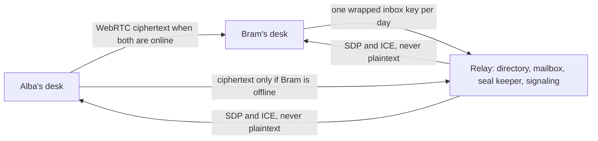

# Hedwig

Hedwig is a peer-to-peer letter desk. You can write whenever you like. You can open the inbox only once each local day. Until that opening, letters stay sealed. Anything that arrives afterward waits for tomorrow.

Two desks in the same browser are enough to try it: give each tab its own `?desk=` name, exchange owl addresses, and send a letter.

## Run

Requires Node.js 22 or newer.

```bash
npm install
npm run dev
```

With Nix, enter the development shell to provide Node.js 22 and pnpm, then
install dependencies and run the app:

```bash
nix develop
pnpm install
pnpm dev
```

- Desk: [http://127.0.0.1:4731](http://127.0.0.1:4731)
- Ciphertext relay: `http://127.0.0.1:4747` (the desk proxies `/v1` and `/ws` to it)

`npm test`, `npm run lint`, and `npm run build` cover the crypto, the daily rule, and the relay.

The relay keeps its mailbox in `data/relay.json`. Delete that file to forget every owl it has seen.

## Two owls

Open two tabs:

- [http://127.0.0.1:4731/?desk=alba](http://127.0.0.1:4731/?desk=alba)
- [http://127.0.0.1:4731/?desk=bram](http://127.0.0.1:4731/?desk=bram)

Each `desk` value is a separate IndexedDB database, so one browser can hold two owls. A normal visit, without `?desk=`, uses one owl per browser profile. Two profiles do not need the query.

1. Name each owl.
2. Copy an address, or show its mark, and add it on the other desk.
3. Write a letter. The other desk shows a sealed count and the sender, not the words.
4. Break the seal. The letter can be read, and the perch will not open again until the next local midnight.
5. Send another letter. It stays in “since you opened” until tomorrow.

The calendar day is the timezone chosen when the owl was created. The relay’s clock decides which day that is.

## Architecture



There is no account server and no message store that can read mail.

| Piece | What it holds | What it cannot do |
| --- | --- | --- |
| Desk | Ed25519 identity key, 32-byte wrap key, opened letters, sealed ciphertext that arrived directly | It does not keep the current inbox private key |
| Relay | Public directory, sealed letters for offline owls, wrapped inbox private keys, WebRTC signaling | It cannot unwrap keys or read subjects and bodies |
| Other owl | Your public address and current inbox public key | They cannot open your letters |

When the recipient is online, the letter is offered over a WebRTC data channel. The relay only forwards SDP and ICE, plus a STUN lookup (`stun.l.google.com`) so two machines on different networks can find each other. A STUN server sees IP addresses, not letters. If the direct channel does not acknowledge within a couple of seconds, the same ciphertext is stored in the recipient’s mailbox until they open the post.

Contacts are the owl address: `owl1` plus the Ed25519 public key and a 4-byte checksum. The mark is a QR code of that string.

## Cryptography

- Identity: Ed25519. The address is the public key. Requests and letters are signed with it.
- Inbox: a fresh X25519 key for each sealed period. Letters use an ephemeral X25519 key, HKDF-SHA256, and XChaCha20-Poly1305. The sender, recipient, letter id, and inbox key are bound as associated data.
- Wrap: the inbox private key is encrypted with XChaCha20-Poly1305 under a random 32-byte key that never leaves the desk. The relay stores only that blob.
- Libraries: [`@noble/curves`](https://github.com/paulmillr/noble-curves), [`@noble/ciphers`](https://github.com/paulmillr/noble-ciphers), and [`@noble/hashes`](https://github.com/paulmillr/noble-hashes).

Opening is one request. The desk generates the next inbox key, wraps it, and sends it up. The relay, in the same step, returns the previous wrapped key and every letter addressed to it, then publishes the new key. Until the desk acknowledges, a retry returns that same batch and does not rotate again. After the acknowledgement, the relay drops the released key. Letters that arrive later are encrypted to the new public key.

The desk also refuses a second opening on its own, using the local date it stored. Both checks have to agree.

## The once-a-day rule

The day is the owl’s locked IANA timezone, measured by the relay clock. The claimed date must be that exact local date. A second opening on the same date is refused. Claiming another timezone, or tomorrow while it is still today, is refused.

This is stronger than a flag in `localStorage`, because the private key needed to read sealed mail is not on the desk until the relay releases it. It is not a time-lock puzzle. A verifiable delay or a drand beacon would unlock at a fixed public time for anyone who has the ciphertext. That does not match “open once, at the moment you choose, and keep later arrivals sealed.” Those tools could be added later as a “not before dawn” floor. They would not, by themselves, enforce a single opening.

### What a determined person can bypass

- **A modified client.** The desk generates the inbox key. A patched app can keep the private key, skip the wrap, and decrypt every arrival immediately. No protocol the honest client follows can stop a client the person rewrites. This is the real limit of v1.
- **The opening response.** It contains the wrapped key and the ciphertext for that batch. Saving it means that batch can be decrypted again later. It does not reveal letters sealed to the next key.
- **Skipping the acknowledgement.** Until the desk acks, the relay will hand the same batch back. The honest desk acks as soon as the letters are saved. Someone who never acks can fetch that one batch again. They still do not get the next key.
- **Their own relay.** Editing `data/relay.json`, or running a relay that ignores the date, releases the wrapped key more often. The wrap key is still only on the desk, so a curious relay operator cannot read the mail. A person who controls both the relay and the desk already can.
- **DevTools on the honest app.** Changing `lastOpenedLocalDate` in IndexedDB does not make the relay release the key again. Clearing the site deletes the identity and the wrap key; it does not unlock the relay’s copy, and the owl is gone.
- **Re-reading opened letters.** After a successful opening the plaintext stays on the desk. “Once” means one unsealing of the sealed batch, not that the letters you have already read disappear.
- **Clock skew around midnight.** The relay’s clock wins. A desk whose clock is on the other side of local midnight from the relay is told the date is implausible. Moving the clock far ahead does not open a future day, because the relay computes the date itself.
- **Metadata.** The relay sees owl addresses, the current inbox public key, ciphertext sizes, and timing. Sender and recipient addresses are outside the seal so the desk can show who is waiting. Subjects and bodies are not.

Identity keys live in IndexedDB. Anyone who can run script in this origin, or who can copy the browser profile, can impersonate the owl and unwrap future inbox keys. This is not a hardware key store.

## Layout

```
src/crypto     addresses, signatures, sealed boxes, key wrap, letters
src/inbox      mockable clock and the once-a-day decision
src/relay      signed requests and the mailbox state machine
src/client     IndexedDB, WebRTC, and the desk session
src/ui         the paper desk
server         HTTP and WebSocket relay
tests          crypto, daily rule, mailbox, and the HTTP relay
```

The daily decision and the mailbox take a `Clock`. Tests use `ManualClock` instead of waiting for midnight.
