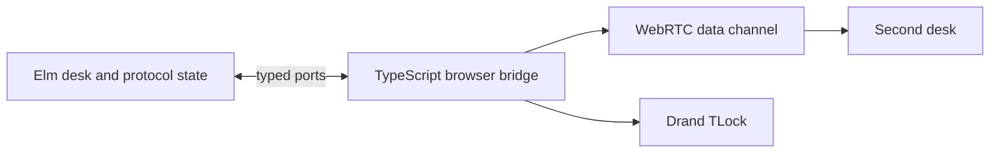

# Ophelia's Rosemaries

Ophelia's Rosemaries is a quiet desk for letters between two friends. Rosemary
is for remembrance: you write whenever you like, seal a letter for a chosen
day, and it stays closed until that day arrives.

It is a static, peer-to-peer page built with Elm and a small TypeScript browser
bridge. Manual WebRTC signaling, Ed25519/X25519 keys, and drand TLock keep a
letter unreadable before the time you chose. Letter addresses still begin with
`owl1`. The repository name remains `hedwig`.

Both friends need to be online at the same time. The MVP has no relay, mailbox,
signaling server, account system, or offline delivery queue.

## Try locally

Requirements:

- Node.js 22
- pnpm
- Nix optional, through the included development flake

```bash
nix develop
pnpm install
pnpm dev
```

Open [http://127.0.0.1:4731](http://127.0.0.1:4731).

To verify a production build:

```bash
pnpm build
```

## Send a letter

1. Open Ophelia's Rosemaries in two browser profiles or tabs.
2. Each person gives the desk a name on the welcome screen.
3. Copy the letter address from **Pair**.
4. One person chooses **Invite a friend**, creates an invitation, and sends that text across.
5. The other chooses **Join a friend**, pastes the invitation, and creates an answer.
6. Send the answer back. Paste it on the inviting desk and choose **Connect**.
7. Write the subject and letter, and choose when it opens.
8. Press the wax seal, **Seal & send**.

Both tabs must remain connected until the transfer is complete. A
`1 second (test)` release preset is available when the page is opened with
`?dev=1`.

## Architecture



### Elm

Elm owns the desk UI and application state:

- your name and letter address;
- manual invitation and answer state;
- letter composer;
- release preset selection;
- sealed inbox state;
- debug activity;
- dark/light theme preference;
- Help & FAQ navigation.

Elm source is in `src/Main.elm`.

### TypeScript bridge

The browser bridge in `src/bridge.ts` owns APIs Elm cannot access directly:

- Ed25519 identity and X25519 exchange keys;
- browser local storage;
- X25519 letter encryption;
- drand/TLock encryption and decryption;
- STUN-assisted WebRTC;
- copy/paste signaling;
- application-level delivery confirmations.

Cryptography uses the packages already in `package.json`: Noble Ed25519,
X25519, Ciphers, Hashes, drand-client, and tlock-js.

### TLock rounds

The release duration is converted to milliseconds, then mapped to a drand
round using the pinned Quicknet chain. This boundary is deliberately tested:
the drand library rejects seconds as timestamps and pre-genesis values.

The letter is protected by two layers:

- X25519: only the named friend can decrypt the letter.
- TLock: the ciphertext cannot be opened before the selected drand round.
- Ed25519: the sender signs the envelope metadata.

## Data and privacy

- Identity keys are stored in browser local storage.
- Clearing browser storage removes the local identity.
- Two browser profiles do not share an identity.
- Plaintext and private keys do not pass through a server.
- STUN may observe network addresses used for connection discovery.
- TLock requires public drand infrastructure to publish future randomness.
- This MVP has not received an independent security audit.

An unsent letter is not guaranteed to survive closing the page. There is no
mailbox or retry server.

## Debugging

The desk includes a collapsed **Details** toggle on the pairing screen showing:

- identity creation or restore;
- ICE gathering;
- peer connection state;
- data-channel open/close;
- envelope send and receive events;
- TLock decryption;
- application delivery confirmations;
- errors.

The same events are written to the browser console with `[Rosemaries]`.

## GitHub Pages

Pushing `main` deploys the static build to GitHub Pages through
`.github/workflows/pages.yml`.

Before pushing, test the repository-subpath build:

```bash
pnpm build:pages
pnpm exec vite preview --host 127.0.0.1 --port 4173 --strictPort
```

For this repository, the preview is at
[http://127.0.0.1:4173/hedwig/](http://127.0.0.1:4173/hedwig/).

GitHub Pages should be configured to use **GitHub Actions** as the source.

## Tests

Run the unit suite:

```bash
pnpm test
```

Run the browser suite:

```bash
pnpm exec playwright install chromium
pnpm test:e2e
```

Coverage currently includes:

- drand millisecond conversion and pre-genesis rejection;
- the 1-second release preset;
- dark-mode default;
- theme switching;
- the welcome screen and mobile section tabs;
- clear field errors for invalid sends.

## Security and operational boundaries

- Identity backup data contains private Ed25519 and X25519 keys. Anyone who
  obtains the file can impersonate the desk and decrypt letters addressed to it.
- Browser local storage does not provide hardware-backed secrecy. Clearing,
  copying, or malicious script access can affect identity and saved mail.
- WebRTC peers and STUN can observe connection metadata and IP addresses.
  Letter bodies remain TLock and recipient-key encrypted.
- Drand TLock provides time-based secrecy, not sender authenticity or a
  hardware trust boundary. The app separately verifies Ed25519 and recipient
  envelope fields.
- Replay protection is local to the recipient browser. A modified client or
  copied browser state can bypass application convenience protections.
- There is no offline mailbox, replication guarantee, or retry server.

## Limitations

- Direct WebRTC may fail behind strict NAT or firewall configurations.
- TURN is intentionally not used.
- Manual signaling requires the peers to exchange invitation and answer text.
- TLock guarantees timing, not metadata privacy or offline availability.
- Browser storage is not hardware-backed.
- The MVP does not implement recovery codes or cross-device identity backup.
